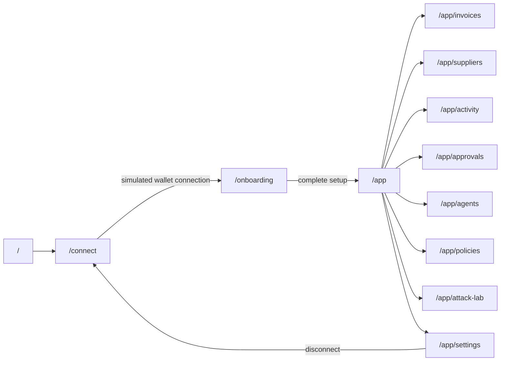
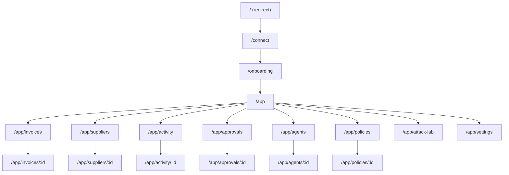
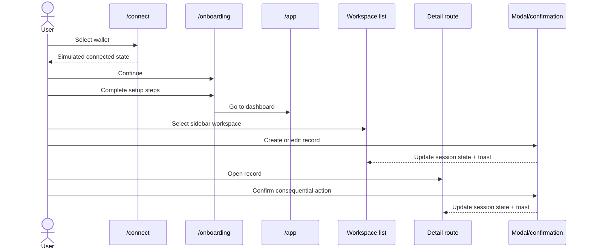

# Airlock Application Handoff

> **Document scope:** This document describes the application exactly as implemented in this repository at the time of handoff. It is an integration reference, not a product specification. Behaviors marked **mock**, **simulated**, **static**, **placeholder**, or **incomplete** are not connected to production wallet, blockchain, backend, or payment infrastructure.

## 1. Application Overview

### Product summary

Airlock is presented as security infrastructure for invoice-bound payments initiated by AI agents. Its core promise is: **“Pay the invoice, not the prompt.”**

The interface models a payment-control layer that compares an agent-initiated payment request against:

- a registered invoice;
- supplier identity and verification;
- the supplier's approved payout wallet;
- the invoice and requested amounts;
- agent and organization spending limits;
- delivery attestation;
- supporting evidence and payment intent;
- human-review requirements.

A request is represented as receiving one of three decisions:

- **ALLOW:** the modeled controls pass;
- **BLOCK:** a modeled control fails;
- **HOLD:** a human decision is required.

The target users shown by the interface are business owners, finance administrators, accounts-payable teams, payment reviewers, and security-conscious organizations that authorize AI agents to initiate payment requests.

### Actual implementation boundary

This repository contains a frontend-only React prototype. It does **not** connect to:

- a wallet provider or wallet SDK;
- a blockchain or RPC endpoint;
- an authentication service;
- a backend/API;
- a database;
- file or object storage;
- an invoice parser;
- a supplier-verification provider;
- a real payment evaluator;
- a transaction-signing or payment-submission service.

Wallet connection, signatures, payment decisions, evidence, transactions, notifications, and system health are simulated in the browser.

### Complete implemented journey

1. `/` redirects to `/connect`.
2. The user selects MetaMask, Coinbase Wallet, or WalletConnect. All three invoke the same 650 ms simulated connection.
3. A fixed connected identity (`0x71C4...9F2A`, Ethereum) is shown.
4. “Continue with this wallet” navigates to `/onboarding`.
5. The user moves through organization, payment setup, security overview, and completion screens.
6. “Go to dashboard” navigates to `/app`.
7. The authenticated shell exposes Dashboard, Invoices, Suppliers, Activity, Approvals, AI Agents, Policies, Attack Lab, and Settings.
8. Selected invoice, supplier, agent, policy, activity, and approval data persists in `sessionStorage`.
9. Disconnecting through Settings returns to `/connect`; there is no real wallet session to revoke.



### Main features and relationships

| Feature | Implemented relationship |
|---|---|
| Wallet onboarding | Simulated connection gates the visual onboarding flow, but `/app` is directly accessible and unguarded. |
| Dashboard | Reads shared invoice and activity arrays for some counts and lists. Several other metrics remain hard-coded. |
| Invoices | Shared session array supports list, creation, status changes, and detail routing. |
| Suppliers | Shared session array supports list, creation, verification, wallet edit, and detail routing. |
| AI agents | Shared session array supports list, creation, limit edits, enable/disable, and policy display. |
| Policies | Shared typed records support creation, controls, limits, and assignment by agent name. |
| Activity/approvals | One shared activity array drives both history and the HOLD queue. Approve/reject changes the decision field. |
| Attack Lab | Uses shared invoice and agent options, but the result is selected from a fixed scenario table rather than calculated from inputs. |
| Settings | Local component state and static values model settings; save actions generally only show a toast. |

---

## 2. Complete Route Documentation

### Routing implementation

Routes are implemented manually in `src/App.tsx` by `useRoute()`, using:

- `window.location.pathname`;
- `window.history.pushState()` / `replaceState()`;
- a `popstate` listener;
- component-level pathname checks.

There is no React Router dependency and no route configuration outside `src/App.tsx`.

Direct browser refresh requires the deployment host to serve the Vite app shell for nested paths. The Vite development server provides the required SPA fallback, but the target integration/deployment must configure this explicitly.

### Route map



### Route details

#### `/`

- **Purpose:** Root entry.
- **Behavior:** `App` immediately replaces the URL with `/connect`.
- **UI:** Briefly renders the same `Onboarding` connection state while the effect runs.
- **Caveat:** No public landing page is implemented in the inspected source. Any existing landing page must be preserved or integrated outside this route logic.

#### `/connect`

- **Page:** Wallet connection.
- **Access:** Root redirect, settings disconnect, or the low-opacity bottom-right logout/demo button in the app shell.
- **Component:** `Onboarding` with `startAt={0}`.
- **Displayed data:** Fixed supported-wallet labels, security copy, and fixed connected address/network after connection.
- **Actions:**
  - MetaMask, Coinbase Wallet, WalletConnect → same simulated connection timer.
  - Disconnect → returns the local component to disconnected state.
  - Continue with this wallet → navigates to `/onboarding`.
- **Loading state:** Button text changes to “Waiting for wallet…” for 650 ms.
- **Success state:** Fixed wallet identity shown.
- **Error state:** None; connection cannot fail.
- **External effect:** None. No provider is opened and no signature is requested.

#### `/onboarding`

- **Page:** Organization and payment setup.
- **Access:** Continue from `/connect`; direct route starts at step 2 with wallet assumed connected.
- **Component:** `Onboarding` with `startAt={1}`.
- **Steps:**
  1. Organization: name, business email, industry, size.
  2. Payment setup: settlement network, reporting currency, maximum invoice amount, approval threshold.
  3. Security overview: static five-control checklist.
  4. Completion: static summary.
- **Actions:** Back, Continue, completed-step shortcuts, Go to dashboard.
- **Submission behavior:** Inputs are uncontrolled and are not validated, stored, or used after navigation.
- **Empty/loading/error states:** None.
- **Completion:** Navigates to `/app`.

#### `/app`

- **Page:** Dashboard overview.
- **Access:** Sidebar Dashboard, onboarding completion, not-found return button.
- **Component:** `Dashboard` within `DashboardApp`.
- **Displayed data:**
  - Funds Protected: fixed `€184,620`.
  - Invoices Paid: derived from session invoice rows whose sixth field is `Paid`.
  - Blocked Payments: fixed `12`.
  - Awaiting Review: derived from shared activity rows with decision `HOLD`.
  - Recent activity: shared activity rows, first five after local filtering.
  - Payment security chart: fixed 142/127/9/6 values.
  - Due invoices: first three non-`Paid` session invoices.
  - Security events: fixed three-event list.
- **Actions:**
  - Run security test → `/app/attack-lab`.
  - View all / View log → `/app/activity`.
  - View invoices → `/app/invoices`.
  - Activity row/details → `/app/activity/:id`.
  - Search and decision filter → filter only the dashboard activity table.
- **Empty state:** `TransactionTable` does not show a dedicated empty message on this page.

#### `/app/invoices`

- **Page:** Invoice directory.
- **Access:** Sidebar, dashboard “View invoices,” detail back action.
- **Components:** `DataWorkspace`, `TransactionTable`-style native table, `CreationForm` in `Modal`.
- **Data:** Session key `airlock-invoices`.
- **Actions:**
  - Register invoice → registration modal.
  - Search → matches any string cell, not only number/supplier.
  - Status filter → `All`, `Open`, `Attested`, `Paid`, `Disputed`.
  - Column header → ascending string sort only.
  - Previous/Next → five records per page.
  - Invoice number/Open → `/app/invoices/:id`.
- **Empty state:** “No matching records.”
- **Success:** New row prepended and toast shown.
- **Errors:** Inline field errors in registration modal.

#### `/app/invoices/:id`

- **Page:** Invoice detail.
- **Access:** Invoice number or Open action.
- **Component:** `EntityDetail` in invoice mode.
- **Lookup:** Exact match of decoded URL segment against invoice row field 0.
- **Displayed data:** Invoice row fields plus static currency, payment history, attestation copy, payment decision, wallet, and agent.
- **Actions:**
  - Back → `/app/invoices`.
  - Dispute invoice → confirmation → field 5 becomes `Disputed`.
  - Attest delivery → confirmation → field 5 becomes `Attested`.
  - View evidence → toast only.
- **Success:** Session invoice row updates and toast appears.
- **Caveats:** Attestation panel always says delivery is confirmed, even when status is Open/Disputed. Payment history and payment information are static and are not joined to the shared activity store.
- **Invalid ID:** Falls back to the invoice list rather than a not-found detail state.

#### `/app/suppliers`

- **Page:** Supplier directory.
- **Data:** Session key `airlock-suppliers`.
- **Actions:** Add supplier modal, search, verification filter, string sort, five-row pagination, detail navigation.
- **Filters:** `All`, `Verified`, `Unverified`, `Review required`.
- **Success:** Supplier row prepended and toast shown.
- **Empty/error:** Shared `DataWorkspace` empty state and modal validation errors.

#### `/app/suppliers/:id`

- **Page:** Supplier detail.
- **Component:** `EntityDetail` in supplier mode.
- **Displayed data:** Session supplier row, fixed supplier ID, Ethereum network, fixed verification date, and static related invoice rows.
- **Actions:**
  - Back → `/app/suppliers`.
  - Edit supplier → modal.
  - Verify supplier (only when not verified) → confirmation.
- **Edit behavior:** Only the submitted payout-wallet string is written back. The supplier name input and change reason are not stored.
- **Verification behavior:** Field 2 becomes `Verified`, field 5 becomes `Active`.
- **Caveat:** Related invoices use the module-level `invoiceRows` seed, not the shared session invoice list.

#### `/app/agents`

- **Page:** AI agent directory.
- **Data:** Session key `airlock-agents`.
- **Actions:** Authorize agent modal, search, Active/Disabled filter, string sort, pagination, detail navigation.

#### `/app/agents/:id`

- **Page:** AI agent detail.
- **Component:** `EntityDetail` in agent mode.
- **Displayed data:** Agent row, static allowed/blocked counts, assigned session policies matched by agent name, static recent activity, static permission list.
- **Actions:**
  - Back → `/app/agents`.
  - Edit limits → modal and writes formatted fields 3 and 4.
  - Disable/enable → confirmation and toggles field 2.
- **Caveats:** Edit-limit form does not verify that daily limit is greater than per-request limit. Activity does not filter by selected agent.

#### `/app/policies`

- **Page:** Payment policy directory.
- **Data:** Session key `airlock-policies`.
- **Components:** `Policies`, policy cards, create-policy `Modal`.
- **Actions:**
  - Policy card → `/app/policies/:id`.
  - Create policy → modal.
- **Success:** New `PolicyRecord` is appended, toast shown, and route changes to its detail.
- **Invalid state:** Invalid numeric relation silently prevents creation after native field validation; no inline error is rendered.

#### `/app/policies/:id`

- **Page:** Policy detail/editor.
- **Access:** Policy card or successful creation.
- **Displayed data:** Name, description, maximum amount, daily cap, five controls, agent assignments, fixed request count, status.
- **Actions:**
  - Back → `/app/policies`.
  - Edit numeric values.
  - Toggle controls.
  - Assign/unassign agents via checkboxes.
  - Save changes → updates shared policy and shows toast.
- **Validation:** `max > 0`, `daily >= max`; failure produces a toast message but uses the default success toast tone.
- **Caveat:** Unknown policy ID falls back to the policy list/create view.

#### `/app/activity`

- **Page:** Full payment-request history.
- **Data:** Session key `airlock-activity`.
- **Actions:** Search all cells, decision filter, agent filter, six-row pagination, open details.
- **Decision options:** All, ALLOW, BLOCK, HOLD.
- **Empty state:** “No activity found.”

#### `/app/activity/:id`

- **Page:** Transaction/activity detail.
- **Displayed data:** Selected row plus fixed payout wallet, fixed intent, fixed evidence label, and mostly fixed rule results.
- **Actions:**
  - Back → `/app/activity`.
  - Supporting evidence → toast only.
- **Decision explanation:** Selected by the row's decision value.
- **Caveat:** ID is the invoice reference. Multiple requests for one invoice are not modeled safely; `find()` selects the first matching row.

#### `/app/approvals`

- **Page:** HOLD approval queue.
- **Data:** Filtered view of the shared activity array where field 4 is `HOLD`.
- **Actions:** Search, agent filter, pagination, open approval detail.
- **Count:** Also drives sidebar badge and dashboard “Awaiting Review.”
- **Empty state:** “Approval queue is clear.”

#### `/app/approvals/:id`

- **Page:** Approval detail.
- **Component:** `ActivityPage` in approval mode.
- **Actions:**
  - Back → `/app/approvals`.
  - Approve payment → confirmation → shared decision becomes `ALLOW`.
  - Reject payment → confirmation → shared decision becomes `BLOCK`.
- **Outcome:** Returns to queue, removes the item from the HOLD-filtered list, updates counts, and shows toast.
- **Blockchain effect:** None; the confirmation explicitly states no blockchain transaction is submitted.
- **Resolved request:** If revisited through the approval URL, the detail remains available but approval buttons are hidden because it is no longer HOLD.

#### `/app/attack-lab`

- **Page:** Security simulation.
- **Component:** `AttackLab`.
- **Scenarios:** Valid request; wallet mismatch; amount manipulation; unverified supplier; duplicate payment; missing delivery; spending limit; missing evidence; intent mismatch; disabled agent.
- **Inputs:** Shared agent options, shared invoice options, requested amount, conditional wallet, intent, conditional evidence.
- **Actions:** Choose scenario, edit inputs, Run simulation, Reset inputs, reopen history entry.
- **Result:** Determined only by selected scenario's static tuple; inputs do not influence the decision.
- **History:** Last five simulations in component memory only; lost on route unmount/refresh.
- **External effect:** None; clearly labeled simulated.

#### `/app/settings`

- **Page:** Settings workspace.
- **Component:** `SettingsPage`.
- **Internal tabs/sections:** Organization profile, Wallet configuration, Team & access, Notifications, Security preferences, Connected identity.
- **Actions:**
  - Section buttons switch local content.
  - Organization save → toast only.
  - Organization cancel → native form reset.
  - Disconnect wallet → confirmation → `/connect`.
  - Add delegated wallet → toast only.
  - Notification toggles → local state; Save preferences → toast only.
  - Security save → toast only.
- **Persistence:** Settings fields and toggles are not stored in session storage.

#### Unknown paths

- Paths not beginning with `/app` show a branded not-found page with “Return to dashboard.”
- Unknown paths beginning with `/app` do **not** show not-found. They fall through `DashboardApp`'s page matching, usually to Dashboard or Settings depending on prefix logic.

---

## 3. Navigation and User Workflow

### Sidebar

Defined by `nav` and `pageRoutes` in `src/App.tsx`.

| Group | Item | Destination |
|---|---|---|
| Overview | Dashboard | `/app` |
| Payments | Invoices | `/app/invoices` |
| Payments | Suppliers | `/app/suppliers` |
| Payments | Activity | `/app/activity` |
| Payments | Approvals | `/app/approvals` |
| Control | AI Agents | `/app/agents` |
| Control | Policies | `/app/policies` |
| Control | Attack Lab | `/app/attack-lab` |
| System | Settings | `/app/settings` |

Additional sidebar behavior:

- Approvals shows a badge equal to the current number of HOLD activity rows.
- The fixed “Protection active / All systems operational” panel is static.
- The wallet profile at the bottom navigates to Settings.
- At `820px` and below, the sidebar becomes an off-canvas panel with scrim and close controls.

### Top navigation

- **Breadcrumb-like title:** Displays `Workspace > current page`; it is visual text, not clickable.
- **Organization popover:** Shows only Northstar Labs. Its organization row has no action.
- **Search popover:** Searches workspace names only and navigates to their root routes.
- **Help popover:** Static explanatory copy and Close button.
- **Notifications popover:** Two static non-clickable notices.
- **Wallet popover:** Static connected-wallet details.
- **Mobile menu:** Opens the off-canvas sidebar.

There is no real keyboard handler for the displayed `⌘ K` hint.

### Settings tabs

Settings uses local button-driven sections rather than routes. Refresh always returns to “Organization profile.”

### Back navigation

Detail pages use explicit in-app back buttons:

- Invoice → invoice directory.
- Supplier → supplier directory.
- Agent → agent directory.
- Policy → policy directory.
- Activity → activity list.
- Approval → approval queue.

The custom router also supports browser Back/Forward via `popstate`.

### Modal entry points

| Entry action | Modal |
|---|---|
| Register invoice | `CreationForm` in invoice mode |
| Add supplier | `CreationForm` in supplier mode |
| Authorize agent | `CreationForm` in agent mode |
| Create policy | Inline policy-creation form in `Modal` |
| Edit supplier | Supplier edit form |
| Edit limits | Agent-limit form |
| Attest/dispute/verify/enable/disable | `ConfirmDialog` |
| Approve/reject | `ConfirmDialog` |
| Disconnect wallet | `ConfirmDialog` |

`Modal` closes through the close button, Escape, or backdrop mouse-down. Focus trapping and focus restoration are not implemented.

### Typical end-to-end navigation



---

## 4. Feature Behaviour

### Wallet connection and onboarding

**Purpose:** Model non-custodial wallet-first access and organization setup.

**Actual behavior:**

- Any wallet option starts the same local timer.
- A fixed address and Ethereum network are displayed.
- No signature, account request, chain check, connection event, rejection, or provider error is implemented.
- Onboarding values are discarded.
- Direct `/app` access is not guarded.

**Integration requirement:** Replace the timer and fixed identity with the existing Airlock wallet/auth architecture. Route authorization, signature verification, chain handling, disconnect events, and onboarding persistence must come from the host codebase.

### Dashboard overview

**Purpose:** Summarize payment protection and operational work.

**Dynamic:** Paid invoice count, total invoice count, HOLD count, recent activity, non-paid invoice list.

**Static:** Funds protected, blocked count, payment security chart, protection policy count, date, greeting name, security-event list.

### Invoice registration and management

**Registration fields and validation:**

| Field | Required | Validation | Stored |
|---|---:|---|---|
| Invoice number | Yes | Non-empty; case-insensitive duplicate check | Yes |
| Supplier | Yes | Must select from current supplier names | Yes |
| Amount | Yes | Numeric > 0 | Formatted string |
| Currency | Yes/default | EUR/USD/GBP | Only currency symbol in amount |
| Issue date | Yes | Non-empty | Yes |
| Due date | Yes | Must not precede issue date | Yes |
| Document reference | Yes | Non-empty | **No** |
| Notes | No | None | **No** |

The resulting row is prepended with status `Open`. It appears in the invoice directory and dashboard due list. It does **not** create activity, update supplier invoice count, or appear in supplier detail's static related-invoice list.

Invoice actions mutate only the status field.

### Supplier registration and management

| Field | Required | Validation | Stored |
|---|---:|---|---|
| Business name | Yes | Non-empty | Yes |
| Business email | Yes | Contains `@` | No |
| Business address | Yes | Non-empty | No |
| Category | Default | None | No |
| Verification reference | No | None | No |
| Payout wallet | Yes | `0x` + 40 hex chars | Stored only in shortened display form |
| Notes | No | None | No |

New suppliers are `Unverified` / `Pending`, have invoice count `0`, and become options in invoice registration.

Verification changes the display status only. No KYB/KYC service or signature is involved.

### AI agent authorization and management

| Field | Required | Validation | Stored |
|---|---:|---|---|
| Name | Yes | Non-empty | Yes |
| Identifier | Yes | Minimum 5 characters | Yes |
| Description | No | None | No |
| Per-request limit | Yes | > 0 | Yes, formatted string |
| Daily limit | Yes | >= per-request | Yes, formatted string |
| Initial status | Default | Active/Disabled | Yes |
| Assigned policy | Default | No validation | **No** |

Agent detail updates status and limits. Assigned policies are derived from `PolicyRecord.assigned`, which stores agent names.

### Payment policies

`PolicyRecord` is the only structured business type in the app. It stores:

- `id`;
- `name`;
- `description`;
- `max`;
- `daily`;
- five booleans in positional order;
- assigned agent-name strings;
- `Active` or `Draft` status.

The five boolean positions are:

1. verified supplier;
2. delivery attestation;
3. agent intent;
4. supporting evidence;
5. two-person approval.

New policies default the first four to true and two-person approval to false. Policy assignments become visible on matching agent detail pages after Save.

Policies do not actually influence activity records or Attack Lab output.

### Payment approvals

The approval queue is not a separate entity. It is `activityRows.filter(row => row[4] === 'HOLD')`.

- Approve changes decision to `ALLOW`.
- Reject changes decision to `BLOCK`.
- The row remains in activity history.
- HOLD-derived counts update.
- No payment, transaction, signature, evidence mutation, audit record, or reviewer identity is created.

### Activity monitoring

Activity rows are six-element string arrays. Search is substring matching over every cell. Details use fixed evidence and rule explanations with a small decision-dependent branch.

No activity is generated by invoice creation, supplier changes, agent changes, policy saves, simulations, or settings changes.

### Attack Lab

The scenario table is deterministic and static. Run selects the tuple matching the scenario:

| Scenario | Fixed result |
|---|---|
| Valid payment request | ALLOW |
| Payee/payout wallet mismatch | BLOCK |
| Invoice amount manipulation | BLOCK |
| Unverified supplier | BLOCK |
| Duplicate payment | BLOCK |
| Missing delivery attestation | HOLD |
| Spending limit exceeded | BLOCK |
| Missing supporting evidence | HOLD |
| Intent mismatch | HOLD |
| Frozen/disabled agent | BLOCK |

Amount, wallet, intent, selected invoice, selected agent, and evidence do not feed an evaluator. The `suppliers` prop is passed but unused.

### Organization and security settings

Settings is mainly presentational:

- Section switching works.
- Notification toggles work while mounted.
- Disconnect navigation works.
- Save buttons show toasts.
- Form values do not update shared/session data.
- Security toggles are visually on but have no click handlers.
- Delegated wallet action only shows a toast.

---

## 5. Component Inventory

All application components are currently defined in **`src/App.tsx`**.

| Component/hook | Purpose | Main routes | Important inputs/interactions |
|---|---|---|---|
| `App` | Top-level route switch | All | Uses `useRoute`; redirects `/`; selects onboarding/app/not-found. |
| `useRoute` | Custom client router | All | `path`, `navigate(to, replace?)`; History API and `popstate`. |
| `Onboarding` | Wallet connection and setup wizard | `/connect`, `/onboarding` | `startAt`, `onWalletConnected`, `onComplete`; local step/wallet/loading state. |
| `DashboardApp` | Authenticated shell and shared stores | `/app*` | Owns session arrays, creation modal, toast, page selection. |
| `Sidebar` | Primary workspace navigation | `/app*` | `page`, `navigate`, mobile open/close, derived approval count. |
| `Topbar` | Context title and popovers | `/app*` | Organization, workspace search, help, notifications, wallet popovers. |
| `Dashboard` | Overview metrics and summaries | `/app` | Shared invoices/activity, navigation callbacks. |
| `Metric` | KPI card | `/app` | Icon, label, value, note, accent. |
| `TransactionTable` | Activity table | Dashboard, activity, approvals | `rows`, optional `onOpen`. |
| `DataWorkspace` | Generic list for invoices/suppliers/agents | Three list and detail route families | Search, filter, sort, pagination, detail lookup, create callback. |
| `EntityDetail` | Mode-specific invoice/supplier/agent details | Entity detail routes | `type`, row, policies, update/back/notify callbacks; local edit/confirm state. |
| `ActivityPage` | Activity list/detail and approval list/detail | Activity and approvals route families | Shared rows/agents; approval mode; decision callback. |
| `Policies` | Policy list, create, and edit | Policy routes | Typed policy records, agents, navigation, save/notify. |
| `AttackLab` | Deterministic scenario simulator | `/app/attack-lab` | Agents/invoices passed; suppliers passed but unused; local history. |
| `SettingsPage` | Tabbed settings UI | `/app/settings` | Local section/toggles; notify and disconnect callbacks. |
| `CreationForm` | Invoice/supplier/agent create forms | Creation modals | `type`, supplier/invoice options, submit/cancel/switch callbacks. |
| `Modal` | Shared dialog shell | Multiple | Escape/backdrop/close behavior; no focus trap. |
| `ConfirmDialog` | Consequential confirmation | Details, approvals, settings | Title/description/labels/callbacks. |
| `Toast` | Timed feedback | `/app*` | Auto-closes after 3.2 seconds; optional tone. |
| `PageHeading` | Page title/action pattern | Most workspaces | Optional action and icon. |
| `Status` | Text + color state chip | Throughout | CSS class generated from string value. |
| `Icon` | Inline SVG switch | Throughout | `IconName`, size; no external icon library. |
| `Logo` | CSS/SVG-like Airlock mark | Onboarding, sidebar, error | Optional compact mode. |
| `useSessionState` | Session persistence wrapper | `DashboardApp` stores | Reads/writes JSON in `sessionStorage`. |

There are no drawers as separate components. The mobile sidebar behaves as an off-canvas navigation panel.

---

## 6. Data and State Management

### Data model summary

Most entities are represented by positional `string[]` rows rather than named TypeScript types.

#### Invoice row

| Index | Meaning |
|---:|---|
| 0 | Invoice number / ID |
| 1 | Supplier name |
| 2 | Formatted amount including symbol |
| 3 | Issue date |
| 4 | Due date |
| 5 | Status |

#### Supplier row

| Index | Meaning |
|---:|---|
| 0 | Supplier name / ID |
| 1 | Shortened or edited payout wallet string |
| 2 | Verification status |
| 3 | Invoice count string |
| 4 | Last payment text |
| 5 | Operational status |

#### Agent row

| Index | Meaning |
|---:|---|
| 0 | Agent name / ID |
| 1 | Agent identifier |
| 2 | Active/Disabled |
| 3 | Formatted per-request limit |
| 4 | Formatted daily limit |
| 5 | Request count string |

#### Activity row

| Index | Meaning |
|---:|---|
| 0 | Reference; currently also treated as invoice ID and route ID |
| 1 | Supplier name |
| 2 | Agent name |
| 3 | Formatted amount |
| 4 | ALLOW/BLOCK/HOLD |
| 5 | Display timestamp |

#### Policy record

Named `PolicyRecord` type described above.

### Seed/mock locations

- Initial invoice rows: module-level `invoiceRows` in `src/App.tsx`.
- Initial dashboard transaction rows: module-level `transactions`.
- Initial supplier, agent, activity, and policy records: inline initial values in `DashboardApp`.
- Static dashboard events and chart values: inline in `Dashboard`.
- Attack Lab scenarios: inline in `AttackLab`.
- Fixed wallet, organization, and settings identity: repeated inline strings.

### Persistence

| Session key | Data |
|---|---|
| `airlock-invoices` | Invoice rows |
| `airlock-suppliers` | Supplier rows |
| `airlock-agents` | Agent rows |
| `airlock-activity` | Activity/approval rows |
| `airlock-policies` | Policies |

`useSessionState` reads JSON on first render and writes whenever state changes. Persistence survives navigation and refresh in the same browser tab/session. It is cleared when browser session storage is cleared. There is no schema/version migration or parse validation beyond a `try/catch`.

Not persisted:

- wallet connection state;
- onboarding data/completion;
- settings;
- Attack Lab inputs/history;
- list search/filter/sort/page state;
- topbar state;
- open dialogs/toasts.

### Relationships and duplication

- Invoice → supplier is a supplier-name string, not an ID/foreign key.
- Policy → agent uses agent-name strings.
- Activity reference doubles as invoice reference and route ID.
- Supplier detail related invoices use the static seed `invoiceRows`, not session invoices.
- Agent recent activity uses static `transactions`, not session activity or agent filtering.
- Invoice detail payment history is static and independent from session activity.
- Dashboard security events are independent static records.
- Agent creation's selected policy is discarded.
- Supplier and invoice counts are not recalculated from relationships.

### Backend/external status

All application data is mock frontend data. The only external runtime request implied by source is the Google Fonts CSS import for Inter.

---

## 7. Forms, Modals, and Interactions

### Form inventory

#### Onboarding organization/payment fields

Inputs are editable but not submitted, validated, or stored. Continue always advances.

#### Register invoice

See the field/validation table in Section 4. Invalid fields receive inline messages. Success prepends a row, closes the modal, and shows “Invoice registered successfully.”

#### Add supplier

See Section 4. The wallet regex is exactly `/^0x[a-fA-F0-9]{40}$/`. Success shortens the wallet before storage and shows “Supplier added successfully.”

#### Authorize agent

See Section 4. The identifier is only checked for length, not uniqueness. Success shows “Agent authorized successfully.”

#### Create policy

Uses native `required`/`min` plus an internal relationship check. Invalid `daily < max` silently returns without custom feedback.

#### Edit supplier

Requires name, wallet, and change reason through native HTML validation. Only wallet is written back. No wallet-format validation is applied here.

#### Edit agent limits

Uses required numeric fields. Does not enforce positive values or daily >= per-request on edit.

#### Settings forms

Organization, notifications, and security forms show success toasts but do not persist submitted values.

### Modal behavior

- Opens by conditional React rendering.
- Close button works.
- Escape works.
- Clicking the backdrop works.
- Cancel works.
- No focus trap, initial-focus management, or focus restoration.
- Page scroll is not explicitly locked.

### Confirmation dialogs

Implemented for:

- invoice delivery attestation;
- invoice dispute;
- supplier verification;
- agent enable/disable;
- approval/rejection;
- wallet disconnect.

No confirmation exists for policy save, supplier wallet edit, or agent limit edit.

### Search/filter/sort/pagination

| Surface | Search | Filters | Sort | Pagination |
|---|---|---|---|---|
| Dashboard activity | All cells | Decision | No | First 5 only |
| Invoice directory | All cells | Status | Ascending string, all columns | 5/page |
| Supplier directory | All cells | Verification/status match | Ascending string | 5/page |
| Agent directory | All cells | Active/Disabled | Ascending string | 5/page |
| Activity | All cells | Decision, agent | No | 6/page |
| Approvals | All cells | Agent; implicit HOLD | No | 6/page |
| Topbar global search | Workspace names only | N/A | N/A | N/A |

Date filtering is not implemented.

### Toast inventory

Examples implemented:

- Invoice registered successfully.
- Supplier added successfully.
- Agent authorized successfully.
- Delivery attested successfully.
- Invoice marked as disputed.
- Supplier verified successfully.
- Agent status/limits updated.
- Payment request approved/rejected.
- Policy created/updated.
- Simulation complete with decision.
- Settings section updated.
- Delegated wallet invitation prepared.
- Wallet disconnected (navigation occurs immediately, so the toast may disappear with component unmount).

Toasts default to success tone. Some validation/failure messages also use success tone because callers do not pass `tone: 'error'`.

### Dropdowns and menus

- Native selects are used for all form/filter selectors.
- Topbar popovers are custom conditional panels.
- Organization popover's organization row has no handler.
- Notification entries are display-only.
- Wallet popover is display-only.
- Popovers do not close on outside click or Escape; clicking the trigger again or a relevant action closes some of them.

### Controls with no or placeholder behavior

- Onboarding organization/payment values are discarded.
- Organization popover row does nothing.
- `⌘ K` is only visual.
- Notification items do nothing.
- “View evidence” and activity evidence produce toasts rather than opening content.
- Delegated wallet invitation produces a toast only.
- Settings save actions produce toasts only.
- Settings security toggles have no click handlers.
- Dashboard fixed events and due-invoice rows are not clickable.
- Low-opacity `.logout-demo` button is a prototype-only escape to `/connect`.
- Attack Lab input changes do not affect outcome.

---

## 8. Design System and Assets

### Stylesheet

All application styling is in **`src/index.css`**, imported by `src/main.tsx`.

Tailwind CSS v4 is imported, but the UI is primarily authored with custom class names and plain CSS rather than Tailwind utility classes.

### Color tokens

Defined in `:root`:

| Token | Value | Use |
|---|---|---|
| `--brand` | `#087f98` | Sea-blue primary actions |
| `--brand-dark` | `#05667b` | Hover/strong brand text |
| `--brand-light` | `#e8f5f7` | Brand-tinted backgrounds |
| `--ink` | `#10232b` | Primary text/navy |
| `--ink-2` | `#334951` | Secondary dark text |
| `--muted` | `#6c7d83` | Supporting text |
| `--line` | `#dfe7e9` | Standard borders |
| `--line-soft` | `#eaf0f1` | Subtle dividers |
| `--surface` | `#ffffff` | Panels |
| `--subtle` | `#f5f8f8` | Secondary surface |
| `--canvas` | `#f1f5f5` | Application background |
| `--green` / `--green-bg` | `#187a55` / `#e9f6ef` | Positive/allowed |
| `--amber` / `--amber-bg` | `#a56509` / `#fff4dd` | Hold/review |
| `--red` / `--red-bg` | `#b83a45` / `#fcecee` | Block/error/destructive |

### Typography

- Font: Inter.
- Source: Google Fonts import at the first line of `src/index.css`.
- Requested weights: 400, 500, 600, 650, 700.
- Fallback: `ui-sans-serif, system-ui, sans-serif`.
- Root size: 14px.
- Most component sizes are explicit pixel values between 8px and 25px.

For integration in a restricted/CSP-controlled environment, replace the remote Google import with the host application's approved font loading strategy.

### Spacing

There is no formal spacing token scale. Repeated values include:

- 8–12px for compact gaps/padding;
- 14–20px for card/form spacing;
- 22–30px for page spacing;
- 42/48px control heights;
- 240px desktop sidebar;
- 30px desktop content padding.

### Radius and elevation

- `--radius-sm: 8px`
- `--radius-md: 12px`
- `--radius-lg: 16px`
- `--shadow`: very light panel shadow
- Modal shadow: `0 28px 80px rgba(16,35,43,.2)`
- Most buttons/inputs use 7–9px radii.

### Icons and logo

- No icon package.
- `Icon` contains hand-authored inline SVG paths in `src/App.tsx`.
- The logo mark is CSS-generated by `Logo` plus `.logo-mark` styles.
- Wallet/provider marks are letter placeholders (`M`, `C`, `W`) rather than official assets.
- Wallet identicons are CSS radial gradients, not address-derived identicons.

### Asset locations

No product image assets are referenced by the application source. Figma-managed site icon/social metadata may be supplied through `.figma/make/site.json` and Vite plugins. No uploaded reference image is used at runtime.

### Motion

- Button hover: `translateY(-1px)` over `.18s`.
- Toggle thumb: `.2s`.
- Mobile sidebar: `.22s`.
- Smooth scroll is used by `navigate()`.
- Wallet loading is a delayed state change, not an animation.
- No reduced-motion media query is implemented.

### Responsive breakpoints

| Breakpoint | Key behavior |
|---|---|
| `1100px` | KPI grid becomes two columns; dashboard becomes one column; settings cards reduce columns. |
| `820px` | Onboarding aside hidden; mobile progress shown; sidebar off-canvas; detail/policy/lab layouts stack; app content margins change. |
| `600px` | Forms and KPI grids become single column; headings/actions stack; tables/toolbars scroll; detail properties become two columns; wallet profile contracts. |

Additional appended media rules adapt settings tabs, policy cards, simulation form, popovers, and toasts.

---

## 9. Dependencies and Project Structure

### Framework/tooling

- React 19
- React DOM 19
- TypeScript 5.7
- Vite 8
- Tailwind CSS 4 via `@tailwindcss/vite`
- oxfmt
- Figma Make Vite plugins in `vite.config.ts`

No router, state-management, form, validation, wallet, Web3, icon, chart, date, or testing library is installed.

### Package scripts

| Script | Command |
|---|---|
| `dev` | `vite` |
| `build` | `vite build` |
| `preview` | `vite preview` |
| `format` | `oxfmt` |

The Figma Make environment starts the dev server automatically. Toolchain versions are Node 22 and pnpm 10.34.3 in `.mise.toml`.

### Environment variables referenced

From `vite.config.ts`:

- `FIGMA_PUBLIC_URL`: build base path.
- `FIGMA_DEV_SERVER_HOST`: dev/preview host.
- `PORT`: dev/preview port, default 8443.

No application secrets, wallet keys, RPC URLs, backend URLs, or API tokens are used.

### Directory overview

```text
.
├── HANDOFF.md                 # This document
├── index.html                 # Figma Make HTML shell/slots
├── package.json               # Scripts and dependencies
├── vite.config.ts             # React, Tailwind, Figma Make plugins, alias, server/build
├── .mise.toml                 # Node and pnpm versions
├── .figma/
│   └── make/
│       └── site.json          # Site metadata consumed by Vite config
└── src/
    ├── main.tsx               # React root, StrictMode, CSS import
    ├── App.tsx                # Entire application, routes, components, mock data, state
    └── index.css              # Tokens and all UI styling
```

### Build notes

The last verified production build succeeded with `mise exec -- pnpm run build`. Vite emitted a non-fatal warning that the main JavaScript chunk exceeds 500 kB.

---

## 10. Integration Considerations

### Suitable for direct visual reuse

The following are mostly presentational and can be extracted with comparatively low business-logic risk:

- `Logo`, `Icon`, `Status`, `Metric`, `PageHeading`;
- panel, table, field, button, status, toast, modal, and responsive CSS patterns;
- `Sidebar`/`Topbar` visual structure after adapting navigation/auth sources;
- onboarding layout and security-process illustration;
- dashboard composition;
- detail-page layout primitives;
- Attack Lab visual result patterns;
- settings section layout.

### Contains prototype business logic

These should be integrated against host services rather than copied as authoritative logic:

- `useRoute`;
- `useSessionState`;
- `DashboardApp` shared stores;
- `CreationForm` validation and row construction;
- `EntityDetail` mutation logic;
- `ActivityPage` approval mutation;
- `Policies` save/assignment logic;
- `AttackLab` scenario selection;
- wallet connection timer and identity state.

### Mock-only areas

- All wallet/auth behavior.
- All organization/user identity.
- All records and financial values.
- All payment decisions and rule results.
- All evidence/document references.
- All supplier verification.
- All activity timestamps.
- System health and notifications.
- Dashboard chart and several metrics.
- Attack Lab evaluator.
- Settings persistence.

### External dependencies

The application has no business-service dependency. The only direct external UI dependency is Google Fonts. Figma Make build plugins and `.figma/make/site.json` are environment-specific.

### Recommended integration mapping

| Prototype area | Existing Airlock codebase should provide |
|---|---|
| Wallet connect | Existing wallet adapter, provider events, chain validation, signature/auth challenge, session and guard |
| Routing | Existing route framework and protected-route conventions |
| Entities | Existing shared TypeScript domain types; avoid positional arrays |
| Lists/details | Existing data source/query engine and stable entity IDs |
| Create/edit forms | Existing API commands, validation schemas, loading/error handling |
| Payment decisions | Existing evaluation engine and immutable evaluation snapshots |
| Approvals | Existing approval command, reviewer identity/signature, audit trail, payment execution boundary |
| Policies | Existing policy schema, conflict detection, assignment relations, effective dates |
| Attack Lab | Existing mock/evaluation engine with deterministic input-derived outcomes |
| Settings | Existing organization/wallet/permissions persistence |
| Toasts/modals | Existing design-system equivalents if available |

### Conflicts and assumptions

1. **Route ownership:** `/` currently redirects to `/connect`; this conflicts with a public landing page mounted at `/`.
2. **Router:** The custom router may conflict with React Router, Next.js, or another host router.
3. **Auth:** `/app` is not protected.
4. **Data types:** Positional arrays conflict with likely typed entities.
5. **Identity keys:** Names and invoice references are used as IDs.
6. **Persistence:** `sessionStorage` should not be merged with backend cache logic without migration/clearing rules.
7. **Currency:** Amounts are formatted strings, which are unsuitable for arithmetic or ledger use.
8. **Dates:** Mixed human-formatted and ISO-like strings are compared/sorted lexically.
9. **Status model:** Status values are free-form strings interpreted by CSS.
10. **Network mismatch:** Onboarding offers Ethereum, Base, Polygon, and Arbitrum, while Settings claims only Ethereum support.
11. **StrictMode:** React StrictMode is enabled; integration side effects must be idempotent.
12. **Figma Vite config:** The target codebase may not need or support the Figma Make plugins.

---

## 11. Critical User Workflows

### 1. New user connects a wallet and completes onboarding

1. Visit `/` → redirected to `/connect`.
2. `Onboarding` renders wallet choices.
3. Select any wallet → local 650 ms loading state.
4. Fixed wallet is displayed.
5. Continue → `/onboarding`.
6. Edit organization/payment fields if desired; values are not stored.
7. Continue through security and completion.
8. Go to dashboard → `/app`.

**Outcome:** Visual access only; no durable auth or onboarding record.

### 2. User registers an invoice

1. Navigate to `/app/invoices`.
2. Click Register invoice.
3. `CreationForm` opens in a wide `Modal`.
4. Complete required fields.
5. Client validation runs.
6. Success prepends a six-field invoice row to `airlock-invoices`.
7. Modal closes and toast appears.
8. Row appears in the directory and dashboard due list.
9. Open row → `/app/invoices/:id`.

**Not updated:** supplier invoice count/history, activity, document/evidence store.

### 3. User adds and verifies a supplier

1. Navigate to `/app/suppliers`.
2. Click Add supplier.
3. Submit valid name, email, address, and full Ethereum wallet.
4. New row is stored as Unverified/Pending.
5. Open `/app/suppliers/:name`.
6. Click Verify supplier.
7. Confirm.
8. Row becomes Verified/Active and toast appears.

**Outcome:** Supplier becomes available in invoice registration immediately after creation. Verification is local only.

### 4. User authorizes an AI agent

1. Navigate to `/app/agents`.
2. Click Authorize agent.
3. Submit name, identifier, limits, status, and optional description/policy selection.
4. Validation checks required identity and initial limit relation.
5. Agent row is prepended to `airlock-agents`.
6. Open `/app/agents/:name`.
7. Edit limits or change status if needed.

**Caveat:** Initial policy selection and description are discarded.

### 5. User creates a policy and assigns it to an agent

1. Navigate to `/app/policies`.
2. Click Create policy.
3. Enter name, description, maximum invoice amount, and daily cap.
4. Submit → new policy is Active with first four controls enabled.
5. Browser navigates to `/app/policies/:id`.
6. Toggle controls and select agent checkboxes.
7. Save changes.
8. Open `/app/agents/:name`.
9. Assigned policy appears if the policy's `assigned` array contains that exact agent name.

### 6. An agent initiates a payment request

**Not implemented.** There is no creation command or workflow for real or mock agent-initiated requests. Initial activity rows are seeded. Attack Lab models a separate simulation that does not add activity.

Integration must provide request ingestion, entity linkage, evidence, evaluation, and activity creation.

### 7. A payment request receives ALLOW, BLOCK, or HOLD

**Production evaluation is not implemented.**

- Seeded activity already contains decisions.
- Attack Lab returns a fixed result based on chosen scenario.
- Approval resolution can change HOLD to ALLOW/BLOCK.

No policy engine computes a decision from current invoice/supplier/agent/policy data.

### 8. User reviews and resolves a held payment

1. Navigate to `/app/approvals`.
2. Queue filters activity to HOLD.
3. Open `/app/approvals/:reference`.
4. Review static/fixed detail and selected-row amount/supplier/agent.
5. Click Approve or Reject.
6. Confirm.
7. Shared activity decision becomes ALLOW or BLOCK.
8. Return to queue.
9. Queue, sidebar badge, and dashboard HOLD count update.

### 9. User runs an Attack Lab simulation

1. Navigate to `/app/attack-lab`.
2. Select one of ten scenarios.
3. Optionally edit visible inputs.
4. Click Run simulation.
5. The selected scenario's fixed decision/explanation is shown.
6. Toast appears and history is prepended.
7. Reset clears result/defaults; history remains until component unmount.

### 10. User reviews the resulting activity record

Attack Lab does **not** create activity. To review an activity record:

1. Navigate separately to `/app/activity`.
2. Filter/search seeded/shared activity.
3. Open `/app/activity/:reference`.
4. Review selected row and static rule/evidence detail.

Integration must connect simulation/payment evaluation output to activity creation if that is desired.

---

## 12. Known Issues and Incomplete Functionality

### Authentication and wallet

- Wallet providers are labels only.
- No wallet SDK/provider, signature, chain switch, rejection, account change, or error state.
- Fixed address is used throughout.
- Direct `/app` access bypasses connection/onboarding.
- Disconnect only navigates.
- Onboarding completion is not persisted.

### Routing

- Custom router has no route params abstraction, loaders, guards, or nested route boundaries.
- Host must provide SPA fallback for refresh.
- Unknown `/app/*` paths may render Dashboard/Settings instead of 404.
- Public landing page is not present in inspected source; `/` redirects to `/connect`.

### Data integrity

- Most entities are positional arrays.
- Names/references are unstable IDs.
- Duplicate agent/supplier names are allowed.
- Currency and amounts are strings.
- Dates use mixed formats and lexical sort.
- No referential updates on rename/wallet change.
- Session storage has no schema/versioning.

### Cross-page consistency gaps

- New invoice does not update supplier count or supplier detail history.
- New invoice does not create activity.
- Supplier detail invoices use static seed data.
- Agent recent activity is static and not filtered.
- Agent request/decision counts are static.
- Invoice payment history and decision are static.
- Policy changes do not evaluate requests.
- Attack Lab does not create activity.
- Dashboard fixed metrics/events do not reflect changes.

### Forms and validation

- Onboarding values are discarded and unvalidated.
- Supplier email validation only checks for `@`.
- Agent identifier is not unique.
- Agent edit limits lack relationship/positive validation.
- Supplier edit wallet lacks address validation; supplier name edit is ignored.
- Policy create relation failure has no custom error.
- Document references and notes are discarded.
- No asynchronous loading/error/retry states for CRUD.

### Settings

- Save actions do not persist.
- Security toggles are non-functional.
- Delegated wallet is toast-only.
- Notifications are static and preferences do not drive them.
- Wallet and identity values are fixed.

### Activity and approvals

- Multiple requests per invoice/reference are not safely supported.
- Rule results, evidence, intent, wallet, and explanations are mostly static.
- Approval does not capture reviewer, comment, timestamp, signature, or audit event.
- Approval does not submit or authorize a transaction.
- Resolved approval remains accessible at its approval URL.

### Attack Lab

- Inputs do not affect decisions.
- `suppliers` prop is unused.
- Selected agent/invoice values are uncontrolled and not read.
- Frozen-agent option rendering is based on display text and may produce repeated disabled-agent option labels.
- History is not persisted.
- There is no evaluation-engine parity guarantee.

### UI/accessibility/interaction

- Modal lacks focus trap and focus restoration.
- Popovers lack outside-click/Escape handling and menu semantics.
- Displayed `⌘ K` shortcut is not implemented.
- Some status labels rely on arbitrary CSS-class generation.
- Reduced-motion preferences are not handled.
- Google Font requires network access.
- Some very small 8–10px text may not be appropriate for production accessibility.
- The low-opacity logout/demo control is not a production navigation pattern.

### Backend/external integrations

None are implemented. Required production integrations include wallet auth, organization persistence, entity APIs, evidence storage, verification, policy evaluation, approvals/audit, notifications, and payment/transaction boundaries.

---

## Integration Checklist

Before reusing the prototype in the existing Airlock codebase:

1. Preserve the existing public landing route and remove/replace this prototype's `/` redirect.
2. Replace `useRoute` with the host router.
3. Add protected-route and onboarding-completion guards.
4. Replace fixed wallet state with the host wallet/auth session.
5. Replace all positional arrays with shared domain types.
6. Replace `useSessionState` with the host data/mock engine.
7. Map create/edit/approval actions to existing commands and error states.
8. Connect invoice, supplier, agent, policy, activity, and approval relationships by stable IDs.
9. Replace Attack Lab's lookup table with the existing evaluator or deterministic mock engine.
10. Reconcile supported networks.
11. Replace static metrics, events, detail histories, and notifications.
12. Decide whether to extract the visual components/CSS into the host design system.
13. Add integration tests for route guards, CRUD, decisions, approval audit, and wallet lifecycle.
